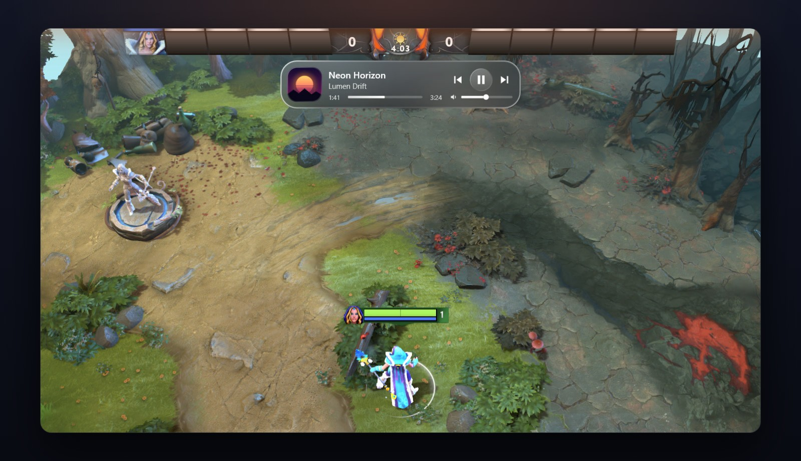
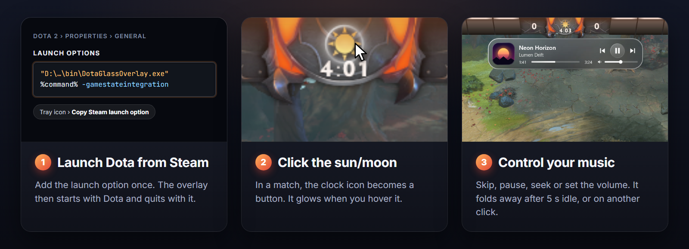

# Dota Glass Overlay

See and control the song playing on your PC without leaving Dota 2. Click the sun/moon in the game clock
and a small glass player drops down: play/pause, skip, seek and volume. Works with Spotify, YouTube,
Apple Music and most other players. Needs Windows 10 or 11.

## Install

1. **Download:** click the green **Code** button at the top of this page → **Download ZIP**. Unzip it to
   a folder you'll keep, for example `C:\DotaGlassOverlay`.
2. **Build:** double-click `build.cmd` in that folder. A few seconds later `bin\DotaGlassOverlay.exe`
   appears. Nothing else to install. If Windows warns you, click **More info → Run anyway**.
3. **Start it:** double-click `bin\DotaGlassOverlay.exe`. A red music-note icon appears in the taskbar
   corner next to the clock (click **^** if you don't see it).
4. **Connect it to Dota:** right-click that icon → **Copy Steam launch option**. In Steam, right-click
   **Dota 2** → **Properties** → paste it into **Launch options**.
5. **In Dota:** Settings → Video → Display mode → **Borderless window**.

That's it. Start Dota from Steam as usual: the overlay starts and closes together with it.

## Use

- Click the **sun/moon** in the clock to open or close the player. It also closes by itself after 5 s.
- Scroll the mouse wheel on the player to change the music's volume.

## Help

- **Nothing shows up in a match:** check that Launch options contain `-gamestateintegration` and Dota is
  in Borderless window mode, then restart Dota.
- **Moved the folder:** copy the launch option again (step 4), otherwise Steam can't start Dota.
- **Uninstall:** delete the launch option in Steam, right-click the tray icon → **Exit**, then delete the
  folder.

[MIT license](LICENSE) · Not affiliated with Valve.
