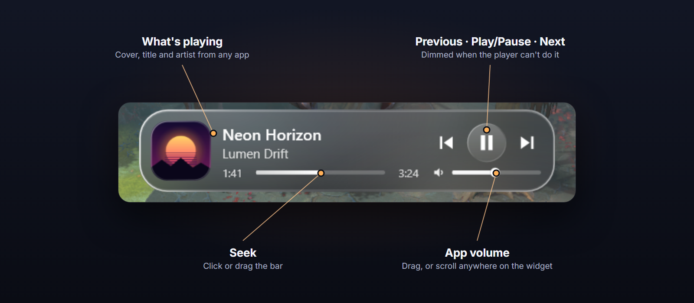

# Dota Glass Overlay

A small "liquid glass" now-playing widget that drops down **under the game clock** in Dota 2.
During a match, the **sun/moon in the clock is a button**: click it to show or hide the widget. Hovering it
shows a soft glass halo, and while the widget is open a faint rim stays around the icon.
The widget folds itself away after **5 seconds without interaction**. It stays open while your mouse is on
it, and the 5 seconds restart after a click, a scroll, or when your mouse leaves it.
Everything hides itself in menus, after the match, and when you alt-tab.


- Shows the cover art, title and artist of whatever is playing on your PC: Spotify, YouTube or SoundCloud in
  any browser, Apple Music, Media Player, Deezer, TIDAL…
- ⏮ ⏯ ⏭ buttons, plus a seek bar you can click or drag
- Volume slider, or **scroll the mouse wheel anywhere on the widget**. This changes the music app's own
  mixer volume, not Dota's, so you can balance music against the game.
- Clicking the widget or the clock button never takes focus away from Dota. The click goes to the overlay,
  not the game.

## How to use




## Setup (one time)

Needs Windows 10 or 11 (the rounded glass needs Windows 11; Windows 10 gets a plain blur) and the
.NET Framework 4.8 that ships with them.

1. **Get the code and build it.** Clone the repo or use **Code → Download ZIP**, then double-click
   `build.cmd`. It uses the C# compiler that ships with Windows, so you don't need to install anything.
   The output is `bin\DotaGlassOverlay.exe` (~100 KB).
2. **Run** `bin\DotaGlassOverlay.exe` once. A red music-note icon appears in the system tray.
   On first start it finds your Dota install and writes
   `…\dota 2 beta\game\dota\cfg\gamestate_integration\gamestate_integration_glass_overlay.cfg`.
3. **Steam → Dota 2 → Properties → Launch options**, set to:
   ```
   "C:\path\to\dota_overlay\bin\DotaGlassOverlay.exe" %command% -gamestateintegration
   ```
   (Tray menu → **Copy Steam launch option** copies this with your real path. Put any options you already
   use after it, e.g. `... %command% -gamestateintegration -novid`.)
   - Pressing **Play** in Steam now starts the overlay, which starts Dota. The overlay quits by itself when
     Dota closes. If Dota restarts itself after an update, the overlay attaches to the new process.
   - `-gamestateintegration` is required: since March 2022 Dota sends no game-state data without it.
   - If you move the `.exe`, update the launch option, otherwise Steam can't start Dota.
   - Prefer it always running? Use tray → **Start with Windows** and keep only `-gamestateintegration` in
     Steam. It uses no CPU outside matches. Both setups can be combined; only one overlay ever runs.
4. **Dota → Settings → Video → Display mode: Borderless window.** Windows can't draw any external
   window over exclusive fullscreen.
5. Restart Dota and start a match (Demo Hero works for testing).

Tray menu: **Preview overlay** (or double-click the icon) shows the widget at the top of your screen so you can
check the look without starting a game. **Copy Steam launch option**, **Start with Windows**,
**Edit settings…**, **Reload settings**, **Exit**.

## Settings (`bin\settings.ini`)

| Key | Default | |
|---|---|---|
| `OffsetY` | `48` | Gap between the top of the game and the widget, in 1080p pixels (scaled to your resolution) |
| `Scale` | `1.0` | Size multiplier. 1.0 matches Dota's HUD size. |
| `ClockButton` | `1` | The sun/moon toggles the widget. Set `0` to show the widget for the whole match instead. |
| `AutoHideSeconds` | `5` | Close the widget after this many idle seconds. `0` = stay open until you click the sun/moon. |
| `ButtonY` | `15.5` | Vertical center of the sun/moon in 1080p pixels. Nudge it if the button sits off-center on your HUD. |
| `ShowInPreGame` | `1` | Also active during the −1:30 countdown |
| `HideWhenNoMedia` | `1` | With `ClockButton=0` only: hide when nothing is playing |
| `OnlyWhenDotaFocused` | `1` | Hide when you alt-tab |
| `Glass` | `blur` | `blur` gives rounded live glass on Windows 11 · `acrylic` · `none` |
| `Port` | `52190` | Local port for Dota's GSI. The .cfg is rewritten automatically. |
| `DotaPath` | | Set this only if auto-detection fails |

## Why it's light

| | |
|---|---|
| Match detection | Valve's official **Game State Integration**. Dota posts a ~200-byte JSON once a second to a loopback-only socket. The app doesn't read game memory or inject anything, so it's VAC-safe. |
| Media | Windows' media session API, the same source the volume flyout uses. Event-driven, with no polling. |
| Glass | The Windows 11 compositor's host-backdrop brush, clipped to an anti-aliased pill. DWM blurs it on the GPU, so this process does no per-frame work for the glass. |
| Rendering | WPF in software mode. It redraws only when something changes, at most about once a second for the time label. Nothing is rendered while hidden. |
| Scheduling | EcoQoS ("efficiency mode") plus below-normal priority, so it never competes with Dota. |
| Measured | Visible during a match: **~0.5 % of one core**. Hidden: **0.0 %**. About 58 MB private memory. |

## Notes

- Windows doesn't expose an app's **queue or playlist**, only the current track. The widget shows the track
  and controls the player.
- Some players don't report a timeline (e.g. some sites in Firefox). The time labels then stay empty and
  seeking is disabled. Prev/next buttons are dimmed whenever the player says they're unavailable.
- The sun/moon button is ready about a second after the match clock appears.
- Troubleshooting: create an empty `bin\trace.log` and restart the overlay. It then logs every game-state
  packet and focus change with timestamps.
- To uninstall, choose Exit in the tray menu and delete the folder and the
  `gamestate_integration_glass_overlay.cfg` file mentioned above.
- The README images are rendered with [Remotion](https://www.remotion.dev) from real in-game captures in
  `docs/readme-images` (`npm i`, then `npm run render`).

## License

[MIT](LICENSE). Dota 2 is a trademark of Valve Corporation. This project isn't affiliated with or endorsed by
Valve.
